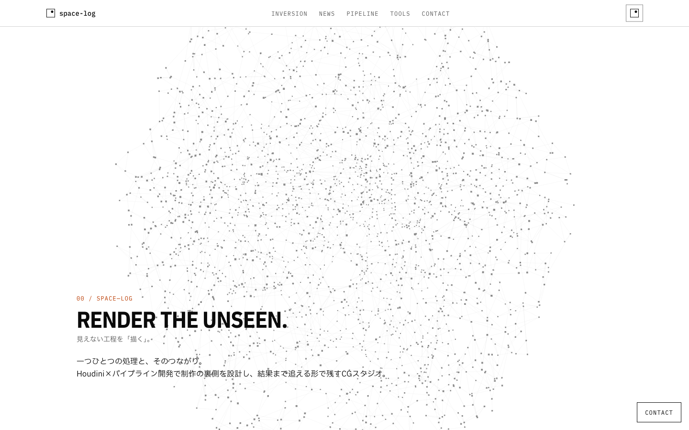
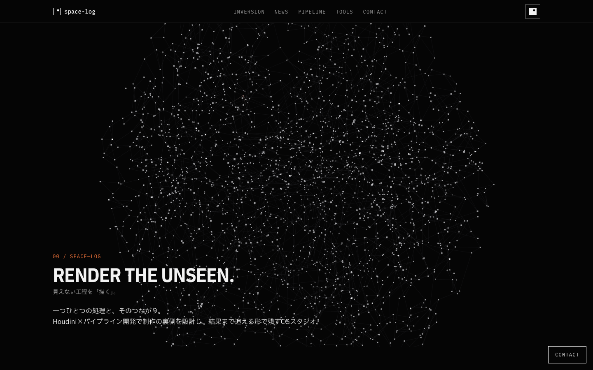
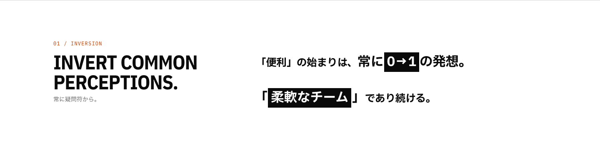
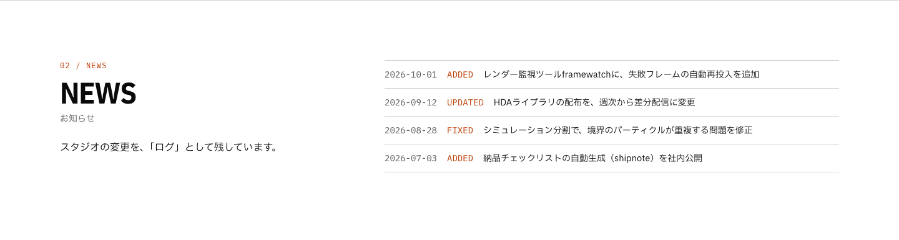
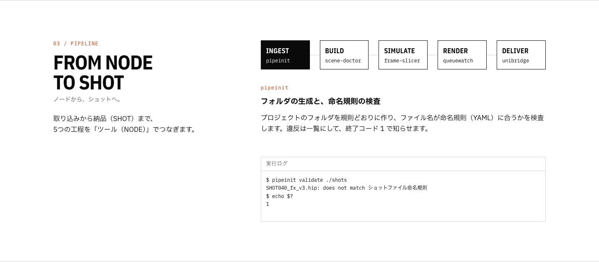
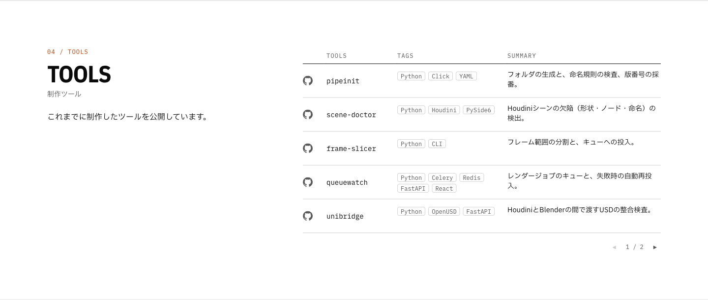
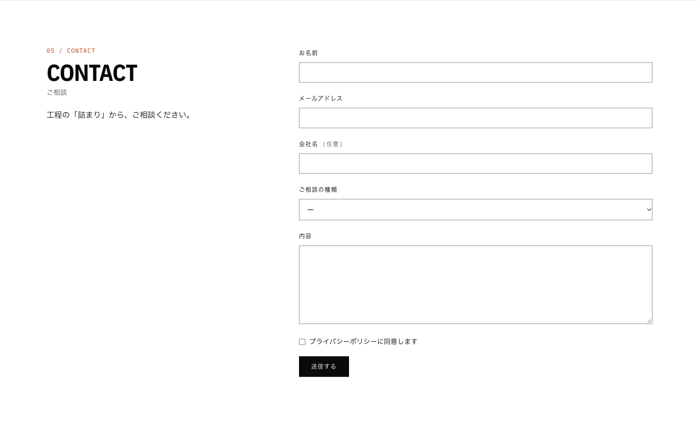

# space-log

[](https://github.com/nokgc333/space-log/actions/workflows/ci.yml)

Houdini とパイプライン開発を専門とする、架空の CG スタジオの 1 ページのサイト。
スタジオは架空だが、サイトは実在し、本番と同じ水準で作っている。

公開サイト: <https://space-log.vercel.app>

## スクリーンショット

ヒーロー(ライトテーマ):



ヒーロー(ダークテーマ):



反転:



お知らせ:



パイプライン:



ツール:



お問い合わせ:



## アーキテクチャ


- ページは、ビルド時に `content/` から生成する。リクエストごとに動くコードは、お問い合わせの Server Action だけ。
- 3D のヒーローは、最初の描画のあと、アイドル時間に読み込む。画面の外にあるとき、タブが隠れているとき、動きを減らす設定のときは、描画を止める。
- コードを読んでも分からない判断には、全て `docs/adr/` に記録がある(下の一覧)。

### プロジェクトの構成

- **`content/`:** ページの全ての文章・数値・リンクを、型のあるデータとして置く(`site.ts`、`sections/`、`privacy.ts`)。お知らせ(`news/`)もここ
- **`src/app/`:** ページ、レイアウト、メタデータのルート(robots、sitemap、manifest、アイコン、リンクのプレビュー画像)、お問い合わせの Server Action
- **`src/components/`:** セクションのコンポーネント(`sections/`)、3D のシーン(`scene/`)、レイアウトの部品、共通の UI 部品、構造化データ
- **`src/lib/`:** コンテンツのスキーマ(`content/schema/`)、お問い合わせの処理、お知らせの読み込み、セキュリティ(ヘッダー、回数制限)、SEO の補助
- **`e2e/`:** 本番ビルドに対して動かす Playwright のテスト
- **`scripts/`:** `content-check.ts`(コンテンツの検査)と `ci-linux/`(Linux のコンテナで CI のジョブを動かす)
- **`docs/adr/`:** アーキテクチャの決定記録
- **`.github/`:** ワークフロー(CI、セキュリティ)、Dependabot の設定、ブランチ保護のファイル

## 技術スタック

- **フレームワーク:** Next.js 16(App Router、Turbopack)と React 19
- **言語:** TypeScript 6(strict)。props、コンテンツ、フォームの値に型をつける
- **スタイル:** Tailwind CSS v4 と `next-themes`
- **フォント:** IBM Plex Sans Condensed、IBM Plex Mono、IBM Plex Sans JP
- **3D:** three.js と React Three Fiber。ヒーローの点群と、信号のネットワークに使う
- **コンテンツ:** zod 4 と `yaml`
- **フォーム:** React Hook Form と zod。クライアントで検査し、サーバーでも同じスキーマで検査する
- **メール:** Resend の REST API(任意)。設定が無いときは、フォームがデモモードで動く
- **単体テスト:** Vitest、Testing Library、jsdom。コンポーネント、純粋関数、コンテンツのスキーマ、Server Action を対象にする
- **E2E テスト:** Playwright(Chromium)。レイアウト、キーボード操作、テーマ、動きを減らす設定、お問い合わせの流れ、レスポンスヘッダーを、実際のブラウザで確かめる
- **品質:** ESLint、Prettier、Lighthouse CI、CodeQL、秘密情報の検査。手元と CI の両方で動かす
- **CI:** Node 24 の GitHub Actions
- **ホスティング:** Vercel

## 動かす

必要なもの:

- Node.js 24(`.nvmrc` のバージョン。CI は最新の 24.x を使う)と、npm 11.19.0 以上。`package.json` と `.npmrc` が、これより古い npm を拒否する
- Docker。CI のジョブを Linux のコンテナで動かしたいときだけ(「変更の検証」を参照)

```bash
nvm use
npm ci
npm run dev
```

サイトは <http://localhost:3000> で開く。お問い合わせフォームは、設定が無くても動く(デモモード)。「環境変数」を参照。

本番ビルドを見るには:

```bash
npm run build
npm run start
```

## スクリプト

- **`npm run dev`:** 開発サーバーを起動する
- **`npm run build`:** 本番用にビルドする
- **`npm run start`:** 本番ビルドを起動する
- **`npm run check`:** lint、型検査、整形の検査、単体テスト。push 前のフックがこれを動かす
- **`npm run lint`:** ESLint。複雑度(10)、関数の長さ(80 行)、入れ子(4)、引数(4)、ファイルの長さ(200 行)に上限がある
- **`npm run typecheck`:** 型検査
- **`npm run format`:** Prettier で整形する(`format:check` は検査だけ)
- **`npm run test`:** 単体テスト(`test:watch` は変更のたびに動かす)
- **`npm run test:coverage`:** カバレッジつきの単体テスト。文・分岐・関数・行のどれかが 95% を下回ると失敗する(CI がこれを動かす)
- **`npm run test:e2e`:** ビルドし、ポート 3100 で起動して、Playwright を動かす
- **`npm run test:perf`:** 本番ビルドに対する Lighthouse CI(先に `npm run build` を動かす)。性能の予算を超えると失敗する
- **`npm run content:check`:** コンテンツの検査。お知らせのファイルと、全てのコンテンツのファイルを、スキーマと照合する。問題を全て列挙する
- **`npm run secrets:check`:** リポジトリ全体の秘密情報を検査する

`src/app/fonts.ts` と `src/app/layout.tsx` は、E2E テストで確かめるので、カバレッジの対象から外している。

## 変更の検証

- **コミット前:** ステージしたファイルを、lint・整形・秘密情報の検査にかける(husky と lint-staged)
- **push 前:** `npm run check` が動き、失敗すると push を止める
- **プルリクエスト:** CI が 3 つのジョブを、セキュリティのワークフローがさらに 3 つを動かす。`main` へのマージには、その全てが通る必要がある

一覧:

- **Lint, typecheck, format, unit test, build:** `npm run lint`、`typecheck`、`format:check`、`test:coverage`、`build`
- **E2E:** Chromium で `npm run test:e2e`
- **Performance Budget:** `npm run test:perf`。レポートは成果物として残す
- **Dependency Audit:** `npm audit --omit=dev --audit-level=high`
- **Dependency Review:** プルリクエストが足す依存関係(プルリクエストのみ)
- **CodeQL:** TypeScript の静的解析

### Linux のコンテナでの CI のジョブ

CI は Linux で動く。小さい文字の幅の丸め方が、プラットフォームによって違うので、レイアウトのテストの一部が影響を受ける。同じジョブを手元で動かすには:

```bash
scripts/ci-linux/run.sh check
scripts/ci-linux/run.sh e2e
scripts/ci-linux/run.sh perf
scripts/ci-linux/run.sh
```

最後のコマンドは、3 つのジョブを 1 つのコンテナで動かす。動いている Docker が要る(Docker Desktop、または 4 GB ほどのメモリの Colima)。git が追跡している(または追跡する)ファイルを `~/.cache/space-log-ci` の下の一時フォルダへ写し、CI と同じ npm で依存関係を入れる。初回は、`package.json` の Playwright のバージョンに合わせたイメージを作る(約 3.5 GB)。

開発用コンテナは、意図して置いていない。Node のバージョン、npm のバージョン、ロックファイルは、すでに固定してあり、コンテナを足しても、数 GB が増える割に得るものが少ない。

## 環境変数

全て任意。無くても、お問い合わせフォームはデモモードで動き、何も送らない。
実際にメールを送るには 3 つ全てを設定する。一部だけだと、フォームは失敗を返し、サーバーのログに足りないものの名前が出る。

- `RESEND_API_KEY`
- `CONTACT_MAIL_FROM`
- `CONTACT_MAIL_TO`

手元では `.env.local`(git の対象外)に、本番ではホストの環境設定に置く。
名前の一覧は `.env.example` にある。

## コンテンツ

ページの全ての言葉と数値は、`content/` にある。
コンポーネントは型のある props だけを受け取り、コンテンツはビルド時に zod で検証する。

`content/` を直接読むのは、ページ、レイアウト、お知らせの読み込み、お問い合わせの Server Action だけ。
3D の色と動きの定数は、`src/components/scene/` にある。

### お知らせを足す

1. `content/news/YYYY-MM-DD-some-words.md` というファイルを作る。日付と言葉には、小文字・数字・ハイフンだけを使う
2. フロントマターを書く。他は要らない(本文は使わない)

   ```md
   ---
   date: "2026-11-01"
   kind: added
   text: "A short line about what changed"
   ---
   ```

   `kind` は `added`、`updated`、`fixed` のどれか。`date` は、ファイル名の日付と同じにする。

3. `npm run content:check` を動かす。誤っているファイルを、理由つきで全て列挙する。直して、通るまで繰り返す
4. `npm run dev` を動かして、お知らせのセクションを見る。ホームには新しい順に出て、残りはページ送りになる

### セクションを変える

他のセクションの文章は、`content/sections/<section>.ts`(hero、inversion、news、pipeline、tools、contact)と `content/site.ts` にある。お知らせのセクションでは、このファイルが見出しとページ送りを持ち、項目は `content/news/` のファイルになる。プライバシーポリシーは `content/privacy.ts` にある。形は `src/lib/content/schema/` の zod のスキーマで決まるので、足りない項目や誤った項目は `npm run content:check` が報告し、ビルドも失敗する。

- ツールには、重複しない `id`(小文字とハイフン)、名前、タグ(1 つ以上)、概要、詳細が要る。リポジトリへのリンクは任意で、`https://github.com/...` の形でなければならない
- パイプラインの段階には、重複しない `id`、段階の名前、ツール、役割、詳細、ターミナルの出力(1 行以上)が要る。段階は 2 つ以上必要

### 公開の前に

- ページを一度読んで、誤字と、スタジオの実態に合わなくなった行を直す
- 足したリンクを全て開く
- 数値を、出典と照らす
- `npm run check` と `npm run content:check` を動かす
- スタジオ、取引先、数値は架空。そのままにして、実在の会社やプロジェクトの名前は出さない

## 設計判断

記録は `docs/adr/` にある。それぞれに、背景、決定、結果、検討した代替案を書いている。

- **[0001](docs/adr/0001-react-three-fiber-hero.md):** ヒーローは、最初の描画のあとに始まる React Three Fiber の点群にする
- **[0002](docs/adr/0002-keep-unsafe-inline-script-src.md):** スクリプトのポリシーは `'unsafe-inline'` を残す(測定した結果。nonce にすると全ページが動的になる)
- **[0003](docs/adr/0003-in-memory-rate-limiting.md):** お問い合わせフォームの回数制限は、メモリ内で行う
- **[0004](docs/adr/0004-content-as-typed-files.md):** 文章は型のあるファイルに置き、スキーマで検査する
- **[0005](docs/adr/0005-mail-through-resend-with-demo-mode.md):** メールは Resend で送り、設定が無いときはデモモードで動く
- **[0006](docs/adr/0006-performance-budgets-and-fonts.md):** 性能は、CI で測った予算で守る。フォントはそのまま残す
- **[0007](docs/adr/0007-quality-gates.md):** 大きさと複雑度の上限、カバレッジの下限、コミット前と push 前の検査
- **[0008](docs/adr/0008-dependencies-and-automation.md):** 依存関係は小さい単位で更新し、一部のメジャーバージョンは意図して据え置く

## アクセシビリティ

Lighthouse のアクセシビリティは、ホームとプライバシーのページで、両方のテーマとも 100。
サイトはキーボードだけで使える(スキップリンク、メニュー、段階のボタン、表のページ送り、フォーム)。スムーズスクロールなどのアニメーションは、動きを減らす設定に従う。
Tab で止まる全ての場所に、同じ 2 px のフォーカスリングが出る(両方のテーマと、強制カラーで確認)。コントラストを上げる設定のときは、控えめな文字と枠線が濃くなる。

## 性能

本番ビルドでの Lighthouse(2026-10-26、各 3 回、Apple M2 の Chrome、範囲は複数回の幅):

- **ホーム**
  - **デスクトップ:** スコア: 0.99〜1.00; 最大の描画(模擬): 0.7 s; ブロッキング時間: 0 ms; 転送量: 1.05 MB
  - **モバイル:** スコア: 0.82〜0.90; 最大の描画(模擬): 3.1〜3.9 s; ブロッキング時間: 169〜266 ms; 転送量: 1.05 MB
- **プライバシー**
  - **デスクトップ:** スコア: 1.00; 最大の描画(模擬): 0.7 s; ブロッキング時間: 0 ms; 転送量: 0.68 MB
  - **モバイル:** スコア: 0.80〜0.94; 最大の描画(模擬): 3.0〜4.2 s; ブロッキング時間: 0〜7 ms; 転送量: 0.68 MB

補足:

- モバイルの数値は、Lighthouse の低速回線の模擬を使っている。模擬なしで測った最大の描画は、この機械で 0.08〜0.15 s(CI では 0.2〜0.4 s)
- 転送量の大半は、日本語フォント(小さい断片で約 450 KB)と three.js(約 245 KB)。残している理由は ADR-0006 にある
- CI にはグラフィックスカードが無いので、ヒーローをソフトウェアで描く。ホームのスコアは約 0.6 で、ブロッキング時間は数秒になる。予算は CI の数値から決めてあり、シーンが軽くなったら下げる
- ヒーローを表示し、その上でポインターを動かし、ツールの表までスクロールした状態で、シーンは Apple M2 上で 59〜61 fps、長いタスクは 0 だった(両方のテーマ)

性能の予算は、プルリクエストごとに検査する(`.lighthouserc.cjs`、Performance Budget のジョブ)。ページごとのモバイルのスコア、最大の描画、JavaScript と転送量の合計、レイアウトのずれ、ブロッキング時間が対象。予算は、測った値に余裕を足したもので、変更でページが軽くなったら下げる。

## 検索と共有

- `robots.txt` がクローラーを入れるのは、本番のデプロイ(`VERCEL_ENV=production`)だけ。プレビューと手元の実行では、全てを拒否し、サイトマップも出さない。`sitemap.xml` には、ホームとプライバシーポリシーを載せる
- 全てのページが、正規の URL、タイトル(`ページ | サイト名`)、リンクのプレビュー用のタグを持つ。ホームには、`WebSite` の記述も JSON-LD で付く
- リンクのプレビュー画像、favicon、Apple のタッチアイコンは、サイトのマークと色から生成する(`src/app/opengraph-image.tsx`、`icon.tsx`、`apple-icon.tsx`)。ブラウザのバーの色は、ライト/ダークのテーマに従う

## セキュリティ

- レスポンスヘッダー:
  Content-Security-Policy、Strict-Transport-Security、X-Content-Type-Options、X-Frame-Options、Referrer-Policy、Permissions-Policy。(`X-Powered-By` は切ってある)
- Content-Security-Policy の `script-src` は、`'unsafe-inline'` を残している。外すにはリクエストごとの nonce が要り、全ページが動的になる(CDN のキャッシュが効かず、手元の測定で応答時間が約 4 倍)。ページはユーザーの入力を表示しないし、ポリシーの他の部分は厳しいままにしている(ADR-0002)
- お問い合わせフォームは、クライアントで検証し、サーバーでもう一度検証する。1 行の欄の制御文字は拒否し、隠したおとり欄を持ち、1 人あたり 10 分で 5 回まで送れる。訪問者は、ホストが `x-forwarded-for` の先頭に置くアドレスで識別する。Vercel では妥当だが、訪問者自身のヘッダーをそのまま通すプロキシの背後では妥当でない(ADR-0003)。メールの件名と送信元は固定なので、訪問者がメールのヘッダーを足すことはできない
- `npm audit --omit=dev` は、本番の依存関係に脆弱性を報告しない。Dependabot、プルリクエストの依存関係レビュー、CodeQL、push の保護つきの秘密情報の検査、コミット前の秘密情報の検査を有効にしている(ADR-0008)
- 本番ビルドのソースマップは公開している(コードはもともと公開)。ブラウザは開発者ツールを開いたときだけ取得するので、訪問者のダウンロードは増えない
- サイトは Cookie を設定せず、選んだテーマだけをブラウザに保存する

## デプロイ

1. Vercel でリポジトリをインポートする。フレームワークは Next.js と判定される
2. 必要なら、3 つのメールの変数を Production と Preview に設定する(「環境変数」を参照)
3. Settings の Deployment Protection で、Protected Source Maps を切る。本番ビルドはソースマップを公開する(コードはもともと公開)。この Vercel の設定はリポジトリに含まれない。入れたままだと、マップは 403 を返す
4. `main` が本番のブランチ。プルリクエストごとにプレビューが付き、プレビューは検索結果に出ない
5. 作業は `main` から切った短命のブランチで行う。`main` へのプルリクエストを開き、全ての検査が通ったら、マージコミットでマージする。マージのあとに、本番へのデプロイが続く
6. ブランチ保護は `.github/branch-protection/` のファイルとして持ち、リポジトリの持ち主が適用する:

   ```bash
   gh api -X PUT repos/<owner>/<repo>/branches/main/protection --input .github/branch-protection/main.json
   gh api -X PUT repos/<owner>/<repo>/automated-security-fixes
   ```

## 依存関係

いくつかのパッケージは、意図して最新のメジャーバージョンより前に据え置いている(ADR-0008):

- `typescript` 6.0: `typescript-eslint` が、まだ TypeScript 6.1 以降を受け付けない
- `@types/node` 24: 型は Node 24 のランタイムに合わせる

`eslint` は 10 を使う。Next.js が同梱する React・JSX のアクセシビリティ・import のプラグインは、宣言上は ESLint 9 までの対応だが、lint は通っている(ADR-0008)。

## クレジット

ツールの表にある GitHub のマークは、[Octicons](https://github.com/primer/octicons) 19.39.0 の `mark-github` アイコン(16 px)。MIT License、Copyright (c) 2026 GitHub Inc.
改変せず、単色で、リポジトリへのリンクとして使っている。
GitHub の名前とロゴは、GitHub, Inc. の商標。

## ライセンス

MIT
