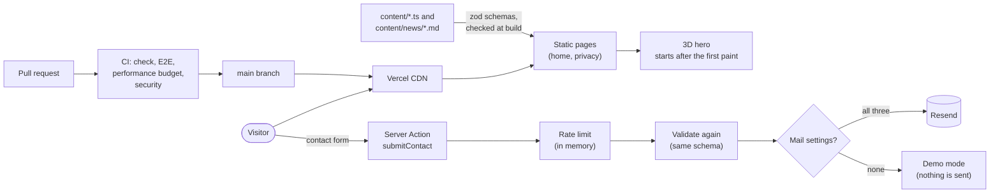

# space-log

A one-page site for a fictional CG studio that specializes in Houdini and pipeline development.
The studio is made up, although the site is real and built to production standards.

Live site: <https://space-log.vercel.app>

## Screenshots

Hero (light theme):


Hero (dark theme):


Inversion:


News:


Pipeline:


Tools:


Contact:


## Architecture



- The pages are generated at build time from `content/`. The only code that runs per request is the contact server action.
- The 3D hero is loaded after the first paint, in an idle period, and stops drawing when it is off screen, the tab is hidden or the visitor asked for less motion.
- Every decision that is not obvious from the code has a record in `docs/adr/` (see the list below).

### Project structure

| Path              | What it holds                                                                                                        |
| ----------------- | -------------------------------------------------------------------------------------------------------------------- |
| `content/`        | Every text, number and link of the page as typed data (`site.ts`, `sections/`, `privacy.ts`), and the news (`news/`) |
| `src/app/`        | Pages, layout, metadata routes (robots, sitemap, manifest, icons, link preview image) and the contact server action  |
| `src/components/` | Section components (`sections/`), the 3D scene (`scene/`), layout parts, shared UI parts and the structured data     |
| `src/lib/`        | Content schemas (`content/schema/`), contact handling, news loading, security (headers, rate limit) and SEO helpers  |
| `e2e/`            | Playwright tests that run against a production build                                                                 |
| `scripts/`        | `content-check.ts` (the content check) and `ci-linux/` (the CI jobs in a Linux container)                            |
| `docs/adr/`       | Architecture decision records                                                                                        |
| `.github/`        | Workflows (CI, security), Dependabot settings and the branch protection files                                        |

## Stack

- **Framework:** Next.js 16 (App Router, Turbopack) and React 19.
- **Language:** TypeScript 6 in strict mode, for typed props, typed content and typed form values.
- **Styling:** Tailwind CSS v4 and `next-themes`.
- **Fonts:** IBM Plex Sans Condensed, IBM Plex Mono and IBM Plex Sans JP.
- **3D:** three.js and React Three Fiber, for the hero point cloud and its network of signals.
- **Content:** zod 4 and `yaml`.
- **Forms:** React Hook Form and zod, with client-side checks and the same schema again on the server.
- **Mail:** Resend through its REST API, optional; without settings the form runs in demo mode.
- **Unit tests:** Vitest, Testing Library and jsdom, for components, pure functions, content schemas and the server action.
- **E2E tests:** Playwright (Chromium), for layout, keyboard use, theme, reduced motion, the contact flow and response headers in a real browser.
- **Quality:** ESLint, Prettier, Lighthouse CI, CodeQL and secret scanning, run locally and in CI.
- **CI:** GitHub Actions on Node 24.
- **Hosting:** Vercel.

## Getting started

Requirements:

- Node.js 24 (the version in `.nvmrc`; the CI uses the latest 24.x) and npm 11.19.0 or newer. `package.json` and `.npmrc` make npm refuse older versions.
- Docker, only if you want to run the CI jobs in a Linux container (see "Verifying a change").

```bash
nvm use
npm ci
npm run dev
```

The site is then at <http://localhost:3000>. The contact form works without any setting (demo mode); see "Environment variables".

To look at the production build instead:

```bash
npm run build
npm run start
```

## Scripts

| Command                 | What it does                                                                                                                 |
| ----------------------- | ---------------------------------------------------------------------------------------------------------------------------- |
| `npm run dev`           | Start the development server.                                                                                                |
| `npm run build`         | Build for production.                                                                                                        |
| `npm run start`         | Start the production build.                                                                                                  |
| `npm run check`         | Lint, typecheck, format check and unit tests. The pre-push hook runs this.                                                   |
| `npm run lint`          | ESLint, with limits on complexity (10), function length (80 lines), nesting (4), parameters (4) and file length (200 lines). |
| `npm run typecheck`     | Type check.                                                                                                                  |
| `npm run format`        | Format with Prettier (`format:check` only checks).                                                                           |
| `npm run test`          | Unit tests (`test:watch` runs them on every change).                                                                         |
| `npm run test:coverage` | Unit tests with coverage; fails below 95% for statements, branches, functions or lines (the CI runs this).                   |
| `npm run test:e2e`      | Build, start on port 3100 and run Playwright.                                                                                |
| `npm run test:perf`     | Lighthouse CI on a production build (run `npm run build` first); fails when a performance budget is exceeded.                |
| `npm run content:check` | Check the content: the news files and every content file against their schemas. Lists every problem.                         |
| `npm run secrets:check` | Scan the whole repository for secrets.                                                                                       |

`src/app/fonts.ts` and `src/app/layout.tsx` are left out of the coverage because the end-to-end tests check them.

## Verifying a change

- **Before a commit:** staged files are linted, formatted and scanned for secrets (husky and lint-staged).
- **Before a push:** `npm run check` runs and stops the push if it fails.
- **On a pull request:** the CI runs three jobs, and the security workflow runs three more. All of them must pass to merge into `main`.

| Job                                       | What it checks                                                           |
| ----------------------------------------- | ------------------------------------------------------------------------ |
| Lint, typecheck, format, unit test, build | `npm run lint`, `typecheck`, `format:check`, `test:coverage` and `build` |
| E2E                                       | `npm run test:e2e` on Chromium                                           |
| Performance Budget                        | `npm run test:perf`, the report is kept as an artifact                   |
| Dependency Audit                          | `npm audit --omit=dev --audit-level=high`                                |
| Dependency Review                         | The dependencies a pull request adds (pull requests only)                |
| CodeQL                                    | Static analysis of the TypeScript                                        |

### The CI jobs in a Linux container

The CI runs on Linux, and some layout tests depend on how a platform rounds the width of small letters. To run the same jobs on your machine:

```bash
scripts/ci-linux/run.sh check
scripts/ci-linux/run.sh e2e
scripts/ci-linux/run.sh perf
scripts/ci-linux/run.sh
```

The last command runs all three jobs in one container. It needs a running Docker (Docker Desktop, or Colima with about 4 GB of memory), copies the files that git tracks or would track to a temporary folder under `~/.cache/space-log-ci`, installs the dependencies with the same npm as the CI and builds an image for the Playwright version in `package.json` on the first run (about 3.5 GB).

There is no dev container on purpose: the Node version, the npm version and the lock file are already pinned, and a container would add several gigabytes for little gain.

## Environment variables

All optional. Without them the contact form runs in demo mode and nothing is sent.
Set all three to send real mail; setting only some makes the form report a failure and the server log name what is missing.

- `RESEND_API_KEY`
- `CONTACT_MAIL_FROM`
- `CONTACT_MAIL_TO`

Put them in `.env.local` (git-ignored) for local use, or in the host's environment settings.
`.env.example` lists the names.

## Content

Every word and number on the page lives in `content/`.
Components only receive typed props, and the content is validated with zod at build time.

Only the pages, the layout, the news loader and the contact server action read `content/` directly.
The 3D colors and motion constants live in `src/components/scene/`.

### Adding a news entry

1. Add a file `content/news/YYYY-MM-DD-some-words.md`. The date and the words use lower-case letters, digits and hyphens only.
2. Write the front matter, and nothing else is needed (the body is not used):

   ```md
   ---
   date: "2026-11-01"
   kind: added
   text: "A short line about what changed"
   ---
   ```

   `kind` is `added`, `updated` or `fixed`. The `date` must be the same as the date in the file name.

3. Run `npm run content:check`. It lists every wrong file with the reason; fix them and run it again until it passes.
4. Run `npm run dev` and look at the news section. The home page shows the newest entries and pages through the rest.

### Changing a section

The texts of the other sections are in `content/sections/<section>.ts` (hero, inversion, news, pipeline, tools, contact) and `content/site.ts` (for the news section the file holds the headings and the paging; the entries are the files in `content/news/`); the privacy policy is in `content/privacy.ts`. Their shapes are the zod schemas in `src/lib/content/schema/`, so a missing or wrong field is reported by `npm run content:check` and fails the build.

- A tool needs a unique `id` (lower-case letters and hyphens), a name, at least one tag, a summary and a detail. Its repository link is optional and must be an `https://github.com/...` address.
- A pipeline stage needs a unique `id`, a stage name, a tool, a role, a detail and at least one line of terminal output. There must be at least two stages.

### Before publishing

- Read the page once for typos and for lines that no longer match what the studio does.
- Open every link you added.
- Check the numbers against their source.
- Run `npm run check` and `npm run content:check`.
- The studio, its clients and its figures are made up; keep it that way and do not name real companies or projects.

## Design decisions

The records are in `docs/adr/`. Each one has the context, the decision, the consequences and the alternatives that were considered.

| Record                                                      | Decision                                                                               |
| ----------------------------------------------------------- | -------------------------------------------------------------------------------------- |
| [0001](docs/adr/0001-react-three-fiber-hero.md)             | The hero is a React Three Fiber point cloud that starts after the first paint          |
| [0002](docs/adr/0002-keep-unsafe-inline-script-src.md)      | The script policy keeps `'unsafe-inline'` (measured; a nonce makes every page dynamic) |
| [0003](docs/adr/0003-in-memory-rate-limiting.md)            | The contact form is rate limited in memory                                             |
| [0004](docs/adr/0004-content-as-typed-files.md)             | The texts live in typed files and are checked with schemas                             |
| [0005](docs/adr/0005-mail-through-resend-with-demo-mode.md) | Mail goes through Resend, and the form runs in demo mode without settings              |
| [0006](docs/adr/0006-performance-budgets-and-fonts.md)      | Performance is guarded by budgets measured on the CI, and the fonts stay as they are   |
| [0007](docs/adr/0007-quality-gates.md)                      | Limits on size and complexity, a coverage floor and checks before each commit and push |
| [0008](docs/adr/0008-dependencies-and-automation.md)        | Dependencies are updated by small steps, and some majors are held back on purpose      |

## Accessibility

Lighthouse accessibility is 100 for the home page and the privacy page, in both themes.
The site works with the keyboard only (skip link, menu, stage buttons, table paging, form), and smooth scrolling and other animation follow the reduced-motion setting.
Every Tab stop shows the same 2 px focus ring (checked in both themes and under forced colors), and the quiet text and borders get darker when the visitor asks for more contrast.

## Performance

Lighthouse on a production build (2026-10-26, three runs each, Chrome on an Apple M2, ranges over the runs):

| Page    | Preset  | Score        | Largest paint (simulated) | Blocking time | Transfer |
| ------- | ------- | ------------ | ------------------------- | ------------- | -------- |
| Home    | Desktop | 0.99 to 1.00 | 0.7 s                     | 0 ms          | 1.05 MB  |
| Home    | Mobile  | 0.82 to 0.90 | 3.1 to 3.9 s              | 169 to 266 ms | 1.05 MB  |
| Privacy | Desktop | 1.00         | 0.7 s                     | 0 ms          | 0.68 MB  |
| Privacy | Mobile  | 0.80 to 0.94 | 3.0 to 4.2 s              | 0 to 7 ms     | 0.68 MB  |

- The mobile numbers use Lighthouse's slow-connection simulation. The largest paint measured without it is 0.08 to 0.15 s on this machine (0.2 to 0.4 s on the CI).
- Most of the transfer is the Japanese font (about 450 KB in small pieces) and three.js (about 245 KB). ADR-0006 explains why they stay.
- On the CI there is no graphics card, so the hero is drawn in software: the home page scores about 0.6 there and its blocking time is several seconds. Its budgets are set from the CI numbers and are lowered when the scene gets cheaper.
- With the hero on screen, the pointer moving over it and scrolled to the tools table, the scene runs at 59 to 61 fps with no long tasks on an Apple M2, in both themes.

Performance budgets are checked on every pull request (`.lighthouserc.cjs`, the Performance Budget job): mobile score, largest paint, JavaScript and total transfer size for each page, plus layout shift and blocking time. The budgets are the measured values plus a margin, and are lowered when a change makes the pages lighter.

## Search and sharing

- `robots.txt` lets crawlers in only on the production deployment (`VERCEL_ENV=production`); previews and local runs disallow everything and list no sitemap. `sitemap.xml` lists the home page and the privacy policy.
- Every page declares its canonical URL, a title (`page | site name`) and link preview tags; the home page also carries a `WebSite` description as JSON-LD.
- The link preview image, the favicon and the Apple touch icon are generated from the site mark and colors (`src/app/opengraph-image.tsx`, `icon.tsx`, `apple-icon.tsx`); the browser bar color follows the light or dark theme.

## Security

- Response headers:
  Content-Security-Policy, Strict-Transport-Security, X-Content-Type-Options, X-Frame-Options, Referrer-Policy, Permissions-Policy. (The `X-Powered-By` header is off.)
- The `script-src` of the Content-Security-Policy keeps `'unsafe-inline'`: removing it needs a per-request nonce, which makes every page dynamic (no CDN cache, about 4 times the response time in a local measurement). The pages show no user input, and everything else in the policy stays strict (ADR-0002).
- The contact form validates on the client and again on the server, rejects control characters in single-line fields, has a hidden trap field, and allows 5 sends per visitor per 10 minutes (ADR-0003).
- `npm audit --omit=dev` reports no vulnerabilities in the production dependencies. Dependabot, a dependency review of pull requests, CodeQL, secret scanning with push protection and a secret scan before each commit are on (ADR-0008).
- The site sets no cookies and stores only the chosen theme in the browser.

## Deployment

1. Import the repository in Vercel; the framework is detected as Next.js.
2. Optionally set the three mail variables for Production and Preview (see "Environment variables").
3. `main` is the production branch. Every pull request gets a preview, and previews are kept out of search results.
4. Work happens on `develop`; open a pull request into `main` and merge it with a merge commit once all checks pass. The deployment to production follows the merge.
5. The branch protection is kept as files in `.github/branch-protection/` and applied by the repository owner:

   ```bash
   gh api -X PUT repos/<owner>/<repo>/branches/main/protection --input .github/branch-protection/main.json
   gh api -X PUT repos/<owner>/<repo>/branches/develop/protection --input .github/branch-protection/develop.json
   gh api -X PUT repos/<owner>/<repo>/automated-security-fixes
   ```

## Dependencies

A few packages are kept behind the latest major version on purpose (ADR-0008):

- `eslint` 9: the React, JSX accessibility and import plugins that Next.js bundles do not accept ESLint 10 yet.
- `typescript` 6.0: `typescript-eslint` does not accept TypeScript 6.1 or newer yet.
- `@types/node` 24: the types follow the Node 24 runtime.

## Credits

The GitHub mark in the tools table is the `mark-github` icon (16 px) from [Octicons](https://github.com/primer/octicons) 19.39.0, MIT License, Copyright (c) 2026 GitHub Inc.
It is used unmodified, in a single color, as a link to a repository.
The GitHub name and logo are trademarks of GitHub, Inc.

## License

MIT
