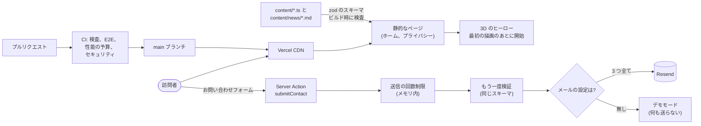

# space-log

[](https://github.com/nokgc333/space-log/actions/workflows/ci.yml)

Houdini とパイプライン開発を専門とする、架空の CG スタジオの 1 ページのサイト。
スタジオは架空だが、サイトは実在し、本番と同じ水準で作っている。

公開サイト: <https://space-log.vercel.app>

## アーキテクチャ



- ページは、ビルド時に `content/` から生成する。リクエストごとに動くコードは、お問い合わせの Server Action だけ。
- 3D のヒーローは、最初の描画のあと、アイドル時間に読み込む。画面の外にあるとき、タブが隠れているとき、動きを減らす設定のときは、描画を止める。
- 設計判断は `docs/adr/` に記録している。

### プロジェクトの構成

- **`content/`:** ページの全ての文章・数値・リンクを、型のあるデータとして置く(`site.ts`、`sections/`、`privacy.ts`)。お知らせ(`news/`)もここ
- **`src/app/`:** ページ、レイアウト、メタデータのルート(robots、sitemap、manifest、アイコン、リンクのプレビュー画像)、お問い合わせの Server Action
- **`src/components/`:** セクションのコンポーネント(`sections/`)、3D のシーン(`scene/`)、レイアウトの部品、共通の UI 部品、構造化データ
- **`src/lib/`:** コンテンツのスキーマ(`content/schema/`)、お問い合わせの処理、お知らせの読み込み、セキュリティ(ヘッダー、回数制限)、SEO の補助
- **`e2e/`:** 本番ビルドに対して動かす Playwright のテスト
- **`scripts/`:** `content-check.ts`(コンテンツの検査)と `ci-linux/`(Linux のコンテナで CI のジョブを動かす)
- **`docs/adr/`:** アーキテクチャの決定記録
- **`.github/`:** ワークフロー(CI、セキュリティ)、Dependabot の設定、ブランチ保護のファイル

## 技術スタック

- **フレームワーク:** Next.js 16(App Router、Turbopack)と React 19
- **言語:** TypeScript 6(strict)。props、コンテンツ、フォームの値に型をつける
- **スタイル:** Tailwind CSS v4 と `next-themes`
- **フォント:** IBM Plex Sans Condensed、IBM Plex Mono、IBM Plex Sans JP
- **3D:** three.js と React Three Fiber。ヒーローの点群と、信号のネットワークに使う
- **コンテンツ:** zod 4 と `yaml`
- **フォーム:** React Hook Form と zod。クライアントで検査し、サーバーでも同じスキーマで検査する
- **メール:** Resend の REST API(任意)。設定が無いときは、フォームがデモモードで動く
- **単体テスト:** Vitest、Testing Library、jsdom。コンポーネント、純粋関数、コンテンツのスキーマ、Server Action を対象にする
- **E2E テスト:** Playwright(Chromium)。レイアウト、キーボード操作、テーマ、動きを減らす設定、お問い合わせの流れ、レスポンスヘッダーを、実際のブラウザで確かめる
- **品質:** ESLint、Prettier、Lighthouse CI、CodeQL、秘密情報の検査。手元と CI の両方で動かす
- **CI:** Node 24 の GitHub Actions
- **ホスティング:** Vercel

## 動かす

必要なもの:

- Node.js 24(`.nvmrc` のバージョン。CI は最新の 24.x を使う)と、npm 11.19.0 以上。`package.json` と `.npmrc` が、これより古い npm を拒否する
- Docker。CI のジョブを Linux のコンテナで動かしたいときだけ(「変更の検証」を参照)

```bash
nvm use
npm ci
npm run dev
```

サイトは <http://localhost:3000> で開く。お問い合わせフォームは、設定が無くても動く(デモモード)。

本番ビルドを見るには:

```bash
npm run build
npm run start
```

## スクリプト

- **`npm run dev`:** 開発サーバーを起動する
- **`npm run build`:** 本番用にビルドする
- **`npm run start`:** 本番ビルドを起動する
- **`npm run check`:** lint、型検査、整形の検査、単体テスト。push 前のフックがこれを動かす
- **`npm run lint`:** ESLint。複雑度(10)、関数の長さ(80 行)、入れ子(4)、引数(4)、ファイルの長さ(200 行)に上限がある
- **`npm run typecheck`:** 型検査
- **`npm run format`:** Prettier で整形する(`format:check` は検査だけ)
- **`npm run test`:** 単体テスト(`test:watch` は変更のたびに動かす)
- **`npm run test:coverage`:** カバレッジつきの単体テスト。文・分岐・関数・行のどれかが 95% を下回ると失敗する(CI がこれを動かす)
- **`npm run test:e2e`:** ビルドし、ポート 3100 で起動して、Playwright を動かす
- **`npm run test:perf`:** 本番ビルドに対する Lighthouse CI(先に `npm run build` を動かす)。性能の予算を超えると失敗する
- **`npm run content:check`:** コンテンツの検査。お知らせのファイルと、全てのコンテンツのファイルを、スキーマと照合する。問題を全て列挙する
- **`npm run secrets:check`:** リポジトリ全体の秘密情報を検査する

`src/app/fonts.ts` と `src/app/layout.tsx` は、E2E テストで確かめるので、カバレッジの対象から外している。
