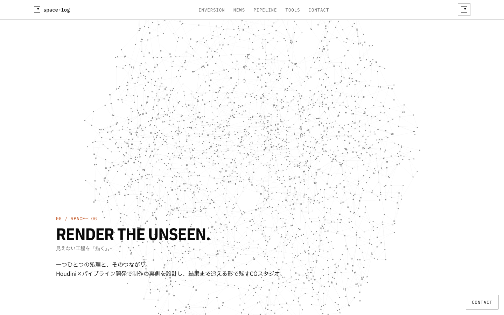
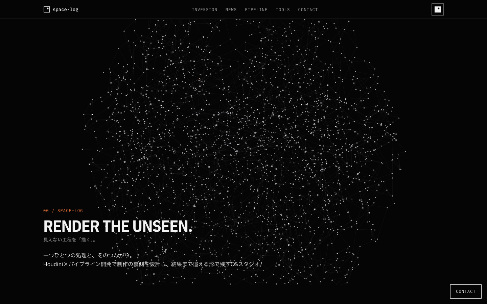
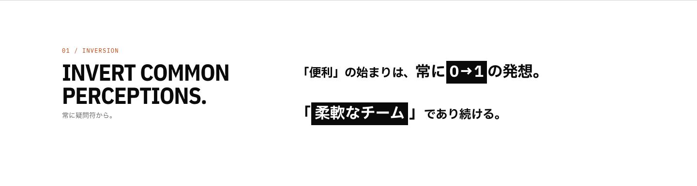
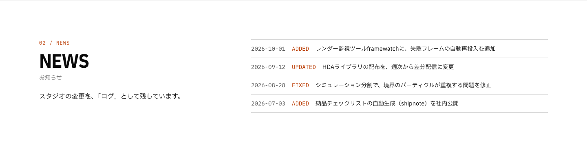
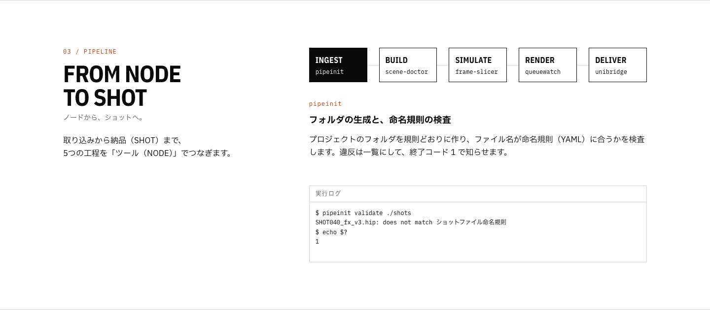
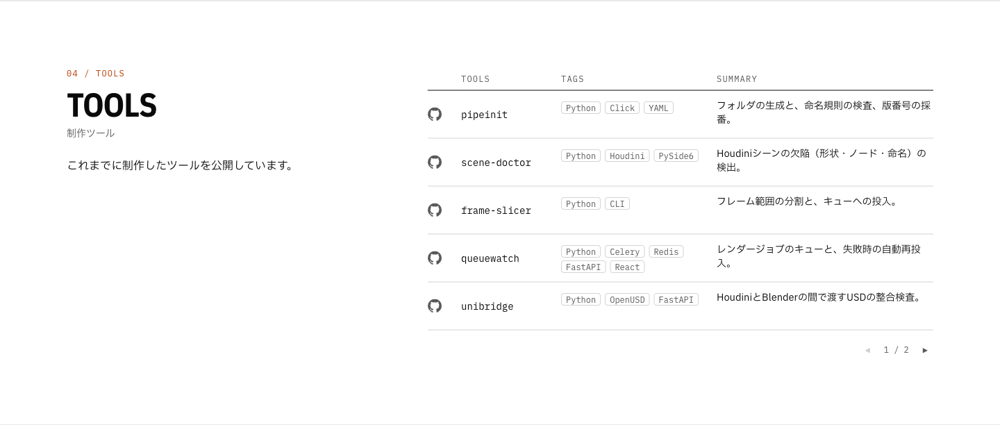
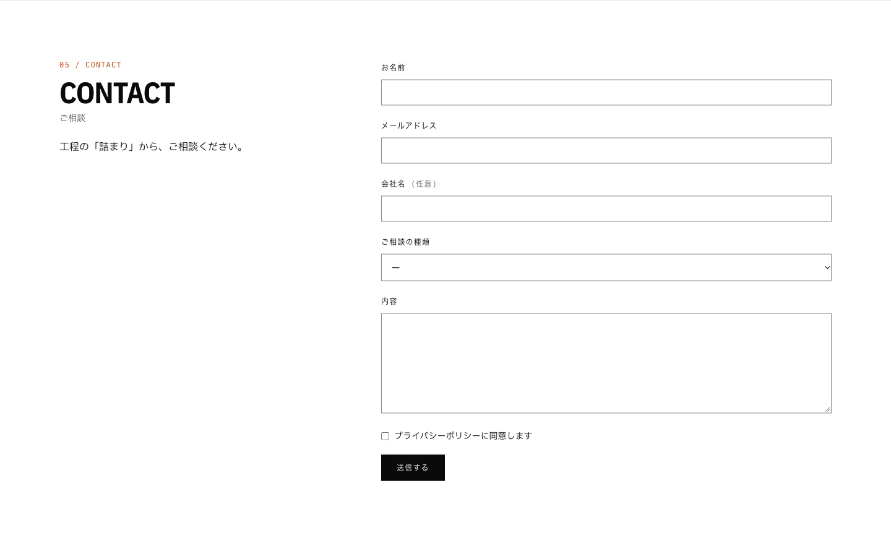

# space-log

A one-page site for a fictional CG studio that specializes in Houdini and pipeline development.
The studio is made up, although the site is real and built to production standards.

Live site: <https://space-log.vercel.app>

## Screenshots

Hero (light theme):

Hero (dark theme):

Inversion:

News:

Pipeline:

Tools:

Contact:

## Stack

- **Framework:** Next.js 16 (App Router, Turbopack) and React 19.
- **Language:** TypeScript 5 in strict mode, for typed props, typed content and typed form values.
- **Styling:** Tailwind CSS v4 and `next-themes`.
- **Fonts:** IBM Plex Sans Condensed, IBM Plex Mono and IBM Plex Sans JP.
- **3D:** three.js and React Three Fiber, for the hero point cloud and its network of signals.
- **Content:** zod 4 and `yaml`.
- **Forms:** React Hook Form and zod, with client-side checks and the same schema again on the server.
- **Mail:** Resend through its REST API, optional; without settings the form runs in demo mode.
- **Unit tests:** Vitest, Testing Library and jsdom, for components, pure functions, content schemas and the server action.
- **E2E tests:** Playwright (Chromium), for layout, keyboard use, theme, reduced motion, the contact flow and response headers in a real browser.
- **Quality:** ESLint and Prettier, run locally and in CI.
- **CI:** GitHub Actions on Node 24.
- **Hosting:** Vercel.

## Scripts

- `npm run dev`: start the development server.
- `npm run check`: lint, typecheck, format check and unit tests.
- `npm run test:coverage`: unit tests with coverage; fails when statements, branches, functions or lines fall below 95% (the CI runs this; `src/app/fonts.ts` and `src/app/layout.tsx` are left out because the end-to-end tests check them).
- `npm run build`: build for production.
- `npm run test:e2e`: build, start on port 3100 and run Playwright.
- `npm run test:perf`: run Lighthouse CI against a production build (run `npm run build` first) and fail when a performance budget is exceeded.

## Content

Every word and number on the page lives in `content/`.
Components only receive typed props, and the content is validated with zod at build time.

Only the pages, the layout, and the news loader read, the contact server action `content/` directly.
The 3D colors and motion constants live in `src/components/scene/`.

## Design notes

- **Inverted space.**
- **One 3D scene, paid for only when seen.**
- **Content as data.**
- **Contact form without a mail account.**

## Environment variables

All optional. Without them the contact form runs in demo mode and nothing is sent.
Set all three to send real mail; setting only some makes the form report a failure and the server log name what is missing.

- `RESEND_API_KEY`
- `CONTACT_MAIL_FROM`
- `CONTACT_MAIL_TO`

Put them in `.env.local` (git-ignored) for local use, or in the host's environment settings.
`.env.example` lists the names.

## Accessibility

Lighthouse accessibility is 100 for the home page and the privacy page, in both themes.
The site works with the keyboard only (skip link, menu, stage buttons, table paging, form), and smooth scrolling and other animation follow the reduced-motion setting.

## Performance

Measured on a production build in Chrome on an Apple M2 (1440×900):

- 59–61 fps and no long tasks with the hero on screen, while the pointer moves over it, and scrolled down to the tools table, in both themes.
- Lighthouse: Performance 99–100 in repeated runs (the first run after a cold start scored lower), Best Practices 100, SEO 100.

Performance budgets are checked on every pull request (`.lighthouserc.cjs`, the Performance Budget job): mobile score, LCP, JavaScript and total transfer size for each page, plus layout shift and blocking time. The budgets are the measured values plus a margin, and are lowered when a change makes the pages lighter.

## Search and sharing

- `robots.txt` lets crawlers in only on the production deployment (`VERCEL_ENV=production`); previews and local runs disallow everything and list no sitemap. `sitemap.xml` lists the home page and the privacy policy.
- Every page declares its canonical URL, a title (`page | site name`) and link preview tags; the home page also carries a `WebSite` description as JSON-LD.
- The link preview image, the favicon and the Apple touch icon are generated from the site mark and colors (`src/app/opengraph-image.tsx`, `icon.tsx`, `apple-icon.tsx`); the browser bar color follows the light or dark theme.

## Security

- Response headers:
  Content-Security-Policy, Strict-Transport-Security, X-Content-Type-Options, X-Frame-Options, Referrer-Policy, Permissions-Policy.(The `X-Powered-By` header is off.)
- The `script-src` of the Content-Security-Policy keeps `'unsafe-inline'`: removing it needs a per-request nonce, which makes every page dynamic (no CDN cache, about 4 times the response time in a local measurement). The pages show no user input, and everything else in the policy stays strict.
- The contact form validates on the client and again on the server, rejects control characters in single-line fields, has a hidden trap field, and allows 5 sends per visitor per 10 minutes.
- `npm audit --omit=dev` reports no vulnerabilities in the production dependencies.
- The site sets no cookies and stores only the chosen theme in the browser.

## Credits

The GitHub mark in the tools table is the `mark-github` icon (16 px) from [Octicons](https://github.com/primer/octicons) 19.39.0, MIT License, Copyright (c) 2026 GitHub Inc.
It is used unmodified, in a single color, as a link to a repository.
The GitHub name and logo are trademarks of GitHub, Inc.

## License

MIT
